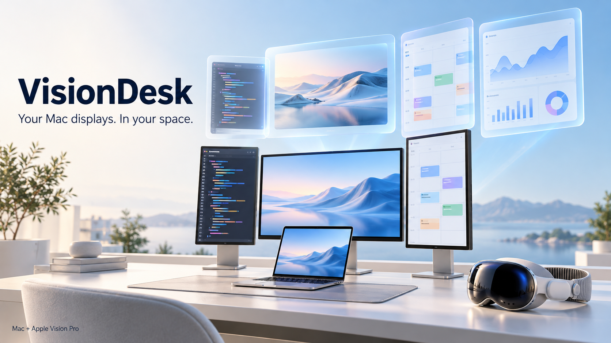
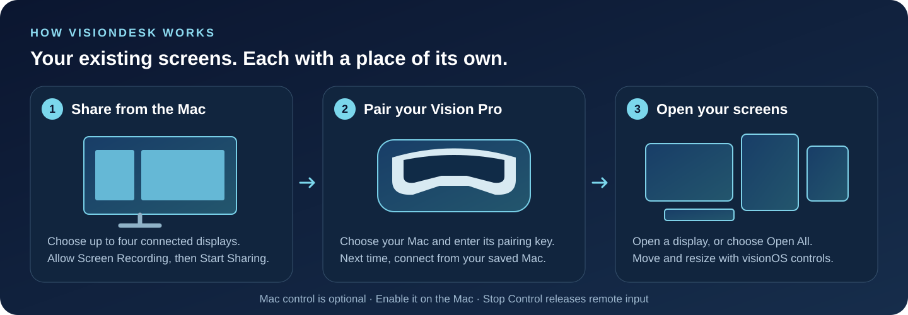
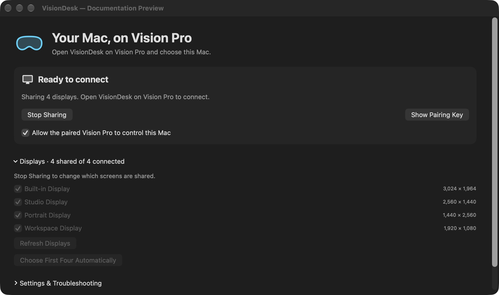
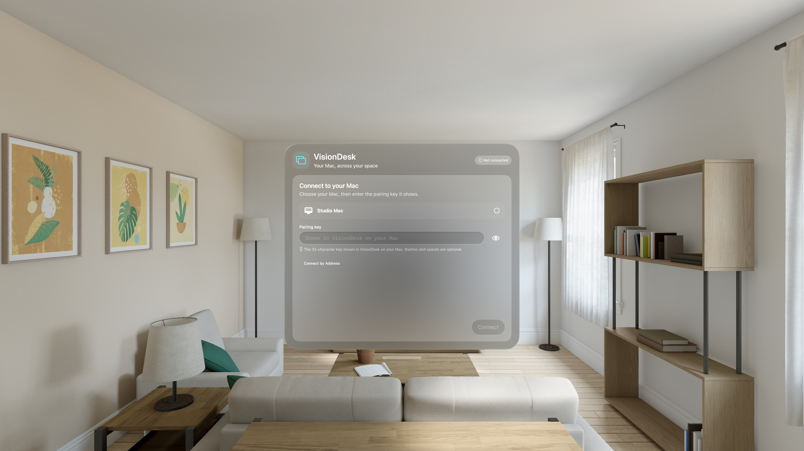
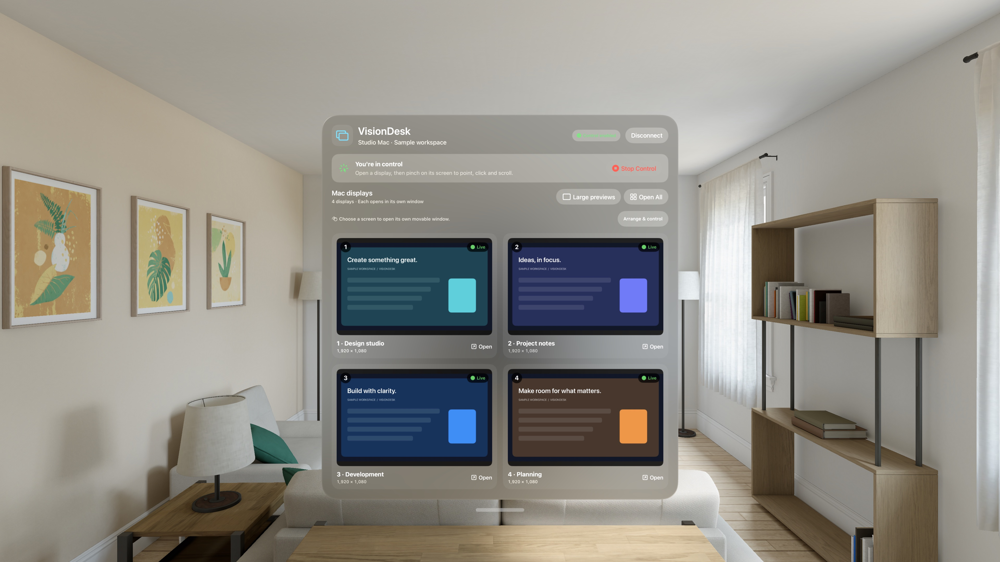
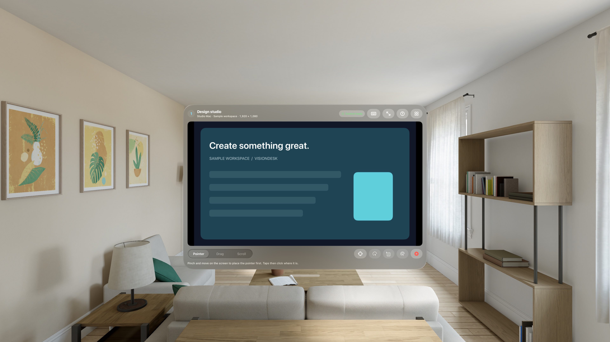

# VisionDesk

  <strong>Up to four Mac displays. A movable Vision Pro window for each one.</strong> 
  <a href="https://github.com/bhino50/VisionDesk/releases">Download the preview</a> ·
  <a href="docs/INSTALL.md">Install &amp; connect</a> ·
  <a href="docs/VISUAL_GUIDE.md">Visual walkthrough</a> ·
  <a href="LICENSE">MIT licensed</a>

**Preview installation:** the Mac download is ad-hoc signed and unnotarized. The Vision Pro download is unsigned and requires your own Xcode signing and provisioning; it is not a one-click headset installer. Start with [Install & connect](docs/INSTALL.md).

VisionDesk shows attached Mac displays and optional extra desktops in separate Apple Vision Pro windows. The Mac companion captures up to four displays, streams hardware H.264 video when available, and accepts optional pointer and keyboard input from the paired headset.

*The cover illustrates the workflow. The app captures below show the real interface with sample state.*

## From your Mac to your space

| Share your screens | Arrange your workspace | Stay in control |
| --- | --- | --- |
| Select up to four attached or extra Mac displays. | Open one screen or use **Open All**. | Pointer, scrolling, and keyboard input are optional. |
| Pair once on a reachable network. | Move and resize windows with visionOS. | **Stop Control** releases remote input. |

## See the app

### Set up sharing on the Mac

Choose which Mac displays to share, start sharing, and reveal the pairing key when needed. The pairing key stays hidden in this documentation capture.

### Pair once on Vision Pro

Choose a nearby Mac and enter its pairing key. A successfully paired Mac can be saved for the next session.

### Choose a screen and open its window

Each preview opens a separate display window. **Open All** opens all shared screens, while control and connection details remain in the overview.

### Work inside a display

Use **Point & Click** to tap a target directly or pinch and move to drag. **Trackpad** keeps clicks at the cursor, and **Scroll** pans a page. The Mouse menu offers secondary click actions; Keyboard opens typing controls. Mac control must be enabled. The screen content here is a synthetic documentation sample.

*These captures document the earlier preview layout; current controls include the Point & Click mode and a consolidated Mouse menu. Mac capture: production SwiftUI view rendered with a documentation fixture. Vision Pro captures: production views running in the visionOS Simulator with synthetic display content. These show the interface rather than a physical-headset session. [Capture details](docs/VISUAL_GUIDE.md#about-these-pictures).*

## Connect

1. Open **VisionDesk Mac** on a logged-in, unlocked Mac. Grant Screen Recording, then start sharing.
2. Open **VisionDesk** on Apple Vision Pro. Allow Local Network access, choose the nearby Mac, and enter the pairing key displayed on the Mac. If it is hidden, click **Show Pairing Key** on the Mac. Both devices must be on a network that allows communication between them.
3. Open a screen window for each display you want to view. Move and resize each window using visionOS window controls.
4. To control Mac applications, click **Allow Accessibility** on the Mac and grant access in System Settings. Then enable **Allow the paired Vision Pro to control this Mac** (or **Enable Mac Control** after connecting). Click the intended Mac application before sending text or keyboard shortcuts.
5. Use **Stop Control** to release remote input, or **Stop Sharing** to stop screen sharing. Closing the Mac companion window can leave sharing active in its menu bar.

The headset can remember a successfully paired Mac. Pairing credentials stay in the devices' Keychains. A stopped or sleeping Mac cannot provide a live stream. Nearby discovery also depends on Local Network permission and network multicast support. Optional remote hosting requires an existing private VPN route configured by the device owner, such as Tailscale or WireGuard. The Mac must advertise a locally assigned private IPv4 or ULA IPv6 address on port 58271; VisionDesk provides no relay, VPN installation, wake, or remote login service.

## Download and install

Follow [Install & connect](docs/INSTALL.md) for the Mac drag-to-Applications download, Vision Pro setup, first connection, and common fixes. Physical Vision Pro installation requires Xcode and your own Apple signing account.

This repository contains source, synthetic tests, and generic app artwork. It excludes personal diagnostics, desktop captures, saved connection data, developer credentials, and development provisioning profiles.

See [BUILD.md](BUILD.md) for local builds, verification, and the privacy release command. The release command prepares:

- An **ad-hoc signed macOS arm64 application**. It has no developer certificate or notarization ticket. macOS may require a deliberate first-open action and fresh privacy permissions.
- An **unsigned visionOS arm64 application**. It is a compiled build for review and signing; installation on a physical Vision Pro requires signing and provisioning through the installer's own Apple development account.

Build and automated-test success do not establish physical headset discovery, picture quality, hand-gesture behavior, or reconnect reliability. Those require a separate check on the intended Mac, network, and headset.

## Troubleshooting

- **Mac not listed:** open the companion, start sharing, allow Local Network access, and check that both devices can communicate. Guest Wi-Fi and client isolation can block discovery. A saved Mac may need pairing again after its Bonjour name changes.
- **Missing or unexpected screens:** open **Displays** in the companion and select up to four screens. To create additional desktops without monitors, stop sharing and choose **Add Desktop** in **Extra desktops**. You can create up to three 1920 × 1080 desktops, then select any four attached or extra screens to share. Extra desktops last only while the Mac companion runs. This optional backend uses an undocumented macOS interface and may be unavailable after an OS change; attached-display sharing remains available.
- **Blank picture:** grant Screen Recording on the Mac, follow any macOS prompt to quit and reopen the app, and keep the Mac logged in, awake, and unlocked.
- **Picture works but input does not:** grant Accessibility, enable Mac control, and use **Request Control** on the headset when available. Focus the intended Mac application before typing.
- **Permissions need granting again after a rebuild:** ad-hoc signing can change the app's identity. Use a stable local signing identity for repeated development.

## Privacy and security

Screen content and control commands travel over an authenticated encrypted connection between the paired devices. Mac control is optional. The app has no analytics uploader, account service, screen recording archive, clipboard synchronization, or cloud relay.

See [PRIVACY.md](PRIVACY.md) for the data boundaries, pairing behavior, and release inspection process. Mac input behavior includes attribution to the MIT-licensed Enigo component; see [third-party attribution](docs/third-party/README.md).

Audio forwarding and automatic login are not implemented. Extra desktops are experimental and use an undocumented macOS interface; compatibility can change with macOS updates.

## License and contributions

VisionDesk is available under the [MIT License](LICENSE). Third-party components retain
their own notices. See [CONTRIBUTING.md](CONTRIBUTING.md) for development checks and
[SECURITY.md](SECURITY.md) for reporting vulnerabilities without exposing private data.
